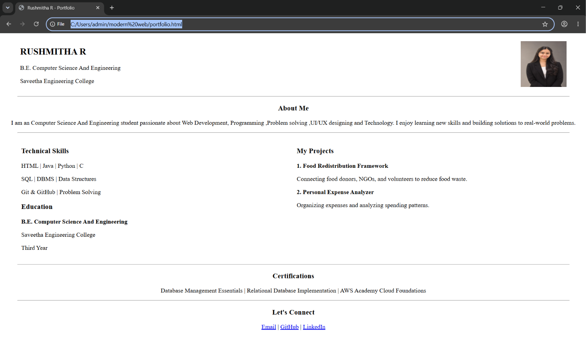

# EXPERIMENT 1 : PORTFOLIO 
## NAME : RUSHMITHA  R
## REGISTRATION NUMBER : 212224040281
## DATE : 30/10/2026

## AIM
To create a Portfolio using HTML and CSS.

## ALGORITHM
### STEP 1
Create an HTML file (index.html)

### STEP 2
Create a CSS file (style.css)

### STEP 3
Include a navigation bar with links to different sections.

### STEP 4
Add structured sections for introduction, about, projects, and contact details.

### STEP 5
Define global styles for fonts, colors, and layout.

### STEP 6
Style the header, navigation bar, and sections.

### STEP 7
Use Flexbox or CSS Grid for layout design.

### STEP 8
Add hover effects and transitions for interactivity.

### STEP 9
Add Images and Media.

### STEP 10
Use optimized images for a professional look.

### STEP 11
Open the HTML file in a browser to check layout and functionality.

### STEP 12
Fix styling issues and refine content placement.

### STEP 13
Deploy the Portfolio.

### STEP 14
Upload to GitHub Pages for free hosting.

## PROGRAM:
```
<!DOCTYPE html>
<html lang="en">
<head>
    <meta charset="UTF-8">
    <meta name="viewport" content="width=device-width, initial-scale=1.0">
    <title>Rushmitha R - Portfolio</title>
</head>
<body>

<center>

    <table width="95%" cellpadding="5">
        <tr>
            <td>
                <h2>RUSHMITHA  R</h2>
                <p>B.E. Computer Science And Engineering </p>
                <p>Saveetha Engineering College</p>
            </td>

            <td align="right">
                
            </td>
        </tr>
    </table>

    <hr width="95%">

    <h3>About Me</h3>

    <p>
        I am an Computer Science And Engineering student passionate about 
        Web Development, Programming ,Problem solving ,UI/UX designing and Technology.
        I enjoy learning new skills and building solutions to
        real-world problems.
    </p>

    <hr width="95%">

    <table width="95%" cellpadding="8">
        <tr>
            <td width="50%" valign="top">
                <h3>Technical Skills</h3>
                <p>HTML | Java | Python | C</p>
                <p>SQL | DBMS | Data Structures</p>
                <p>Git & GitHub | Problem Solving</p>

                <h3>Education</h3>
                <p><b>B.E. Computer Science And Engineering</b></p>
                <p>Saveetha Engineering College</p>
                <p>Third Year</p>
            </td>

            <td width="50%" valign="top">
                <h3>My Projects</h3>

                <p><b>1. Food Redistribution Framework</b></p>
                <p>Connecting food donors, NGOs, and volunteers
                to reduce food waste.</p>

                <p><b>2. Personal Expense Analyzer</b></p>
                <p>Organizing expenses and analyzing spending
                patterns.</p>

            </td>
        </tr>
    </table>

    <hr width="95%">

    <h3>Certifications</h3>
    <p>
        Database Management Essentials | Relational Database
        Implementation | AWS Academy Cloud Foundations
    </p>

    <hr width="95%">

    <h3>Let's Connect</h3>

    <p>
        <a href="mailto:sshreyeshkar@gmail.com">Email</a>
        |
        <a href="https://github.com/SHREYESHKAR"
           target="_blank">GitHub</a>
        |
        <a href="https://www.linkedin.com/in/shreyeshkar-sekar-31b96332a"
           target="_blank">LinkedIn</a>
    </p>

</center>

</body>
</html>
```


## OUTPUT:



## RESULT
The program for creating Portfolio using HTML and CSS is executed successfully.